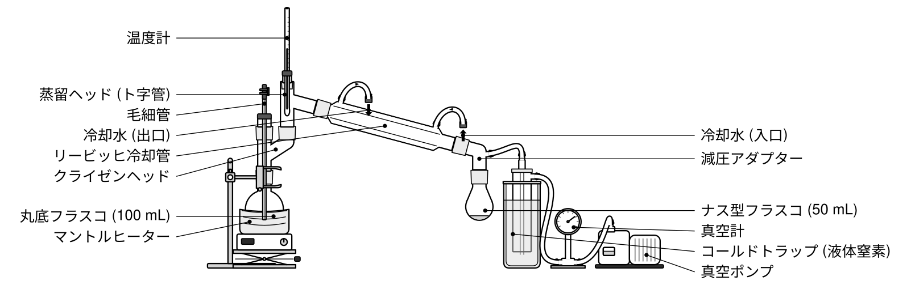
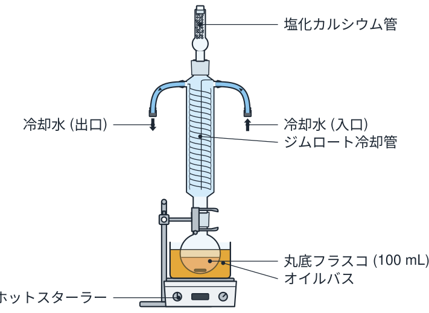

# 実験装置図メーカー

実験器具を**積み木のようにつないで**、論文・レポートにそのまま貼れる実験装置図を作るウェブアプリです。
ブラウザだけで動き、サーバーへの送信はありません。

- 公開先 (GitHub Pages): `https://<ユーザー名>.github.io/graph-app/apparatus/`
- ライブラリ・ビルド不要 (素の ES モジュール)。`index.html` を静的サーバーで開けば動きます。

<p>


</p>

## できること

| | |
|---|---|
| **積み木のように組む** | 部品を選んだ状態で一覧の部品を押すと、空いている口に自動でつながります (フラスコ → クライゼンヘッド → 蒸留ヘッド → 冷却管 …)。ドラッグして口を近づけても吸い付いてつながります。 |
| **すり合わせの規格** | 14/20・24/40 などのオス/メスを区別します。大きさ違いをつなぐと、動かした側の大きさを自動で合わせます。 |
| **自動調整** | マントルヒーター・油浴は載せたフラスコに合わせた大きさに。温度計の球部は蒸留ヘッドの枝管の高さに、毛細管はフラスコの底まで自動で入ります。減圧アダプターの出口は冷却管の傾きに関係なく鉛直になります。 |
| **自動整列** | 机に置く物を同じ床に揃え、受け器が机に当たらないようラボジャッキの高さを合わせ、スタンドをクランプの位置に立てます。蛇口などホースだけでつながる物は相手の近くに置きます。 |
| **ホース** | ホース口どうしを順に押すと、曲線のホースでつなぎます。冷却水は流れの向きの矢印が自動で付きます。 |
| **ラベル** | 番号 + 凡例 / 番号だけ / 名前を直接、を選べます。引き出し線は左右に振り分け、重ならないよう自動で並べます。日本語と英語。 |
| **装置の確認** | 冷却水のつなぎ忘れ・逆向き、密閉した装置の加熱などを警告します。 |
| **書き出し** | SVG (ベクター)・PNG (300〜1200 dpi)・印刷 / PDF。図の幅 (1 段 85 mm、2 段 175 mm など) を決めると、線の太さ (mm) と文字の大きさ (pt) が書き出した図の上で指定どおりになります。 |
| **描き方** | 線画 (白黒) とカラー。 |

ひな形: 減圧蒸留・常圧蒸留・加熱還流・不活性ガス下の反応 (三口)・吸引ろ過・滴定・分液・ガスバーナー加熱。

## ライセンス

- 作った図: **CC0 (パブリックドメイン)**。出典の表示なしで論文・レポート・授業資料に使えます。
  器具の絵はすべてこのアプリのコードが描いたもので、他の素材は使っていません。

## しくみ (開発者向け)

```
js/
  geom.js         行列・角度・外接矩形
  draw.js         パスの組み立て、部品の形 (Shape)、すり合わせ・ホース口などの共通の形
  parts/          部品の定義 (registry.js に define する)
  scene.js        図のデータ (doc) と、つながりから位置を決める計算 (solve)
  layout.js       自動整列
  compose.js      部品・ホース・ラベル・凡例を 1 枚の SVG に組み立てる (縮尺・線の太さ・文字の大きさ)
  render.js       部品の形 → SVG
  theme.js        線画・カラーの色
  checks.js       装置の確認
  templates.js    ひな形
  export.js       SVG・PNG・印刷・保存
  app.js          画面の操作
```

- 部品は「形を描く関数 + 接続口の一覧」です。接続口は種類 (`joint` すり合わせ、`base`/`stage` 底と台、`stem`/`mouth` 足と口、`hose` ホース口、`grip` クランプ) と、位置・外向きの向きを持ちます。
- つながった部品は 1 つの剛体として動き、根の部品から順に「相手の口と向かい合う位置」を計算します (`solve`)。
- 新しい部品の足し方は `js/parts/registry.js` の先頭のコメントを見てください。

```sh
npm test            # 位置計算・ひな形・確認のテスト (Node 20 以上)
npm run gallery     # 全部品を並べた gallery.html を書き出す (見た目の確認用)
```
